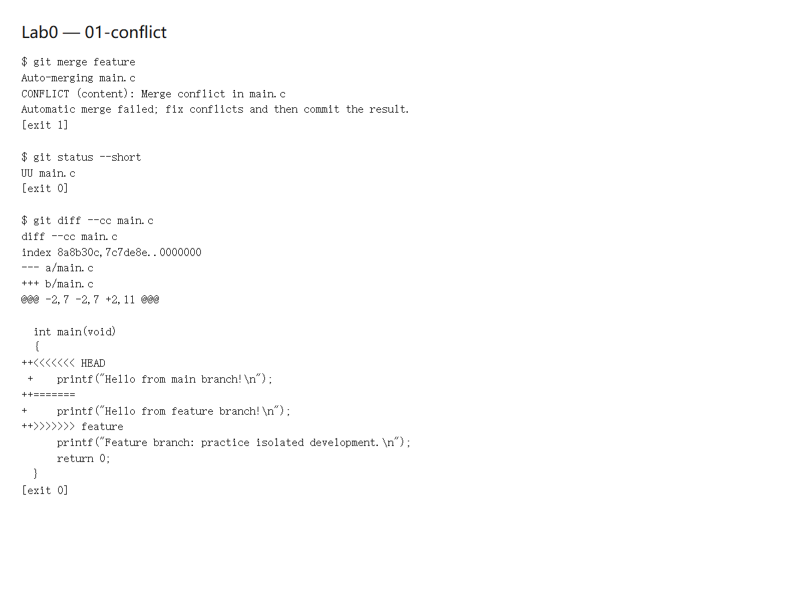
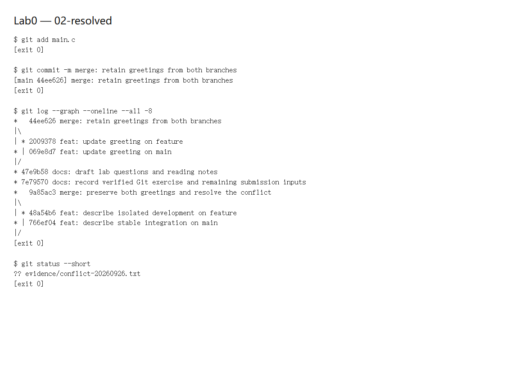

# Lab0：GitLab

张圣皓 25803050063

## 问答

### 多人协作经历

无。

### 为什么分成暂存和提交两步

一次修改可能混着几件事。暂存区让我先选出这次要交的部分，再用一次 commit 保存成一个有明确目的的版本。`git add` 保存的是当时的文件内容，之后继续改文件不会自动进入暂存区，所以提交前还要检查差异。

### git branch 和 git branch -a

`git branch` 列本地分支，`git branch -a` 还会列远程跟踪分支。远程跟踪分支是本地保存的记录，想更新它们还需要 `git fetch`。

## 两篇阅读材料

### Commit Message 规范

提交说明可以用“类型、范围、简短描述”组织，例如 `feat: add greeting`。标题写清改了什么，较复杂的改动再用正文说明原因；需要时注明不兼容变化或关联问题。统一格式能让提交历史更容易看，也方便生成变更日志。

### 语义化版本

版本号写成“主版本.次版本.修订版本”：不兼容的接口变化升主版本，向后兼容的新功能升次版本，兼容的修复升修订版本。已经发布的版本不应偷偷修改，而应发新版本；预发布后缀表示还不稳定。

Git 对我最有用的是能保留清楚的修改记录，出问题时知道哪里改过，也能恢复旧版本。分支让我先做实验，再把确认好的改动合回去；多人一起写时也容易分工和检查。

## 实验过程

1. 修改了模板里的 `main.c`，完成打印字符串的 TODO 并提交。
2. 新建 `feature` 分支，把第一条输出改为 `Hello from feature branch!`，提交后切回 `main`。
3. 在 `main` 上把同一行改为 `Hello from main branch!`，再提交。两条分支修改了共同祖先中的同一行，而且内容不同，所以合并时 Git 无法自动决定保留哪一条。
4. 执行 `git merge feature`，出现 `CONFLICT (content)`。此时 `git status --short` 显示 `UU main.c`，文件中也出现了冲突标记。下面是本次实际命令输出的截图：



5. 删除冲突标记，保留两个分支的问候语，各输出一行。然后执行 `git add main.c` 和 `git commit` 完成合并。日志中的合并提交有两个父提交；代码已不再处于冲突状态。截图里的未跟踪文件是另外保存的冲突文本记录。



6. 用 GCC 的 C11 模式加 `-Wall -Wextra -Werror` 编译，编译、运行都成功。最终输出为：

```text
Hello from main branch!
Hello from feature branch!
```

两张截图对应的原始命令输出保存在 `evidence/commands-20260926.json`。课程模板中的 `.github` 自动评分文件没有修改。

## 参考

- [Commit message 和 Change log 编写指南](https://www.ruanyifeng.com/blog/2016/01/commit_message_change_log.html)
- [语义化版本 2.0.0](https://semver.org/lang/zh-CN/)
- [git-add](https://git-scm.com/docs/git-add) 与 [git-branch](https://git-scm.com/docs/git-branch)
